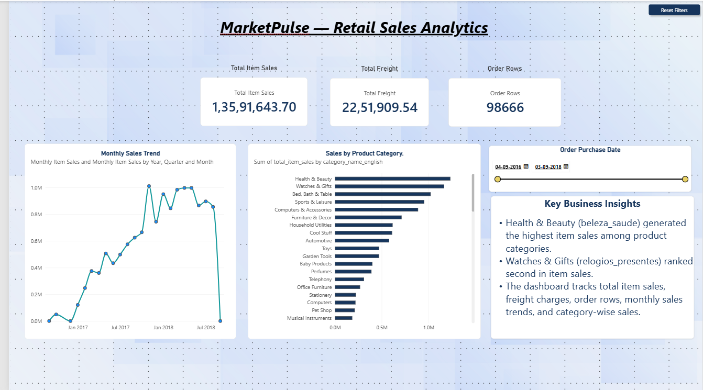

# MarketPulse — Retail Sales Analytics

## Project Overview
MarketPulse is a retail sales analytics project built to analyze e-commerce order data, product category sales, freight charges, monthly sales trends, and delivery performance.

The goal is to turn raw sales data into useful business insights through SQL analysis and an interactive Power BI dashboard.

## Tools Used
- **MySQL:** Data querying and analysis
- **Microsoft Excel:** Data preparation and product category name translation
- **Microsoft Power BI:** Interactive dashboard and data visualization

## Key Business Insights
- Health & Beauty generated the highest item sales among the analyzed product categories.
- Watches & Gifts ranked second in item sales.
- November 2017 and May 2018 were among the strongest months for delivered item sales.
- The average delivery time for delivered orders was approximately 12.5 days.
- Approximately 91.89% of delivered orders were delivered on or before the estimated delivery date.
## Dashboard Preview

## Dashboard Features
- Total Item Sales KPI
- Total Freight Charges KPI
- Order Row Count KPI
- Monthly Item Sales Trend
- Sales by Product Category
- Date slicer for filtering the analysis period
- Reset Filters button using a Power BI bookmark

## Data Scope
The project uses the Brazilian e-commerce public dataset from Olist. The analysis focuses on item sales and delivery performance.

**Important limitation:** Item sales are not the same as profit. Product costs and other business expenses are not included in this analysis, so actual profit is not calculated.

## Project Files
- `MarketPulse_Retail_Sales_Analytics.pbix` — Power BI dashboard
- `MarketPulse_SQL_Analysis.sql` — SQL analysis queries
- `MarketPulse_Order_Analysis.xlsx` — Excel analysis workbook
- `MarketPulse_Order_Analysis_New.csv` — Order-level analysis data
- `MarketPulse_Category_Sales_English.csv` — Category sales data with English category names

## Learning Outcomes
- Writing SQL queries for business analysis
- Preparing and validating data in Excel
- Building interactive Power BI visuals
- Identifying business trends and communicating insights

